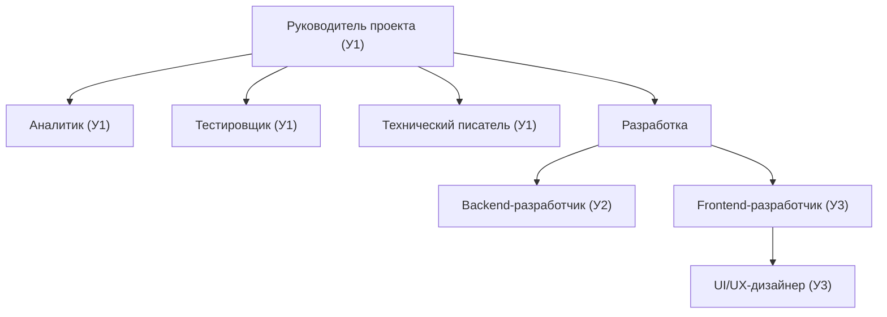

## П1. Практическая работа №1. Анализ загрузки и решение командного конфликта

### Исходная ситуация

До промежуточной демонстрации осталось две недели. Руководитель составил план:

| Участник | Доступно часов в неделю | Запланировано часов |
| --- | --- | --- |
| Аналитик | 15 | 12 |
| Frontend-разработчик | 20 | 30 |
| Backend-разработчик | 20 | 24 |
| Тестировщик | 15 | 5 |
| Дизайнер | 10 | 4 |

Параллельно возник конфликт: frontend не может продолжать без готового API; backend не успевает, потому что исправляет ошибки в базе данных; тестировщик свободен, но не получает сборки.

### Задание 1. Расчёт загрузки

Загрузка = запланированные часы / доступные часы × 100 %.

| Участник | Доступно | Запланировано | Загрузка | Вывод |
| --- | --- | --- | --- | --- |
| Аналитик | 15 | 12 | 80 % | резерв 3 ч |
| Frontend-разработчик | 20 | 30 | 150 % | перегружен на 10 ч |
| Backend-разработчик | 20 | 24 | 120 % | перегружен на 4 ч |
| Тестировщик | 15 | 5 | 33 % | свободно 10 ч |
| Дизайнер | 10 | 4 | 40 % | свободно 6 ч |

Выводы:

- перегружены frontend (150 %) и backend (120 %) - это риск срыва демонстрации;
- свободные ресурсы: тестировщик (10 ч), дизайнер (6 ч), аналитик (3 ч), всего 19 ч;
- перегруз - 14 ч; свободных часов больше, но распределять их можно только по квалификации, а не механически.

### Задание 2. Перераспределение работ

| Работа | Часы | Кому передаём | Почему это допустимо |
| --- | --- | --- | --- |
| Описание API-контракта (спецификация) | 2 | Backend --> Аналитик | контракт - часть требований, аналитик их ведёт и документирует |
| Подготовка тестовых данных для проверки БД | 2 | Backend --> Тестировщик | данные готовятся по схеме, править код БД не нужно |
| Смоук-проверка UI по сценариям | 3 | Frontend --> Тестировщик | ручная проверка готовых экранов, без правок production-кода |
| Mock-сервер по согласованному контракту | 3 | Frontend --> Тестировщик | mock собирается по спецификации; если квалификации не хватит - остаётся у frontend |
| Адаптивная вёрстка | 4 | Frontend --> Дизайнер | дизайнер делает макеты и владеет вёрсткой |

Новое распределение:

| Участник | Доступно | Было | Стало | Загрузка |
| --- | --- | --- | --- | --- |
| Аналитик | 15 | 12 | 14 | 93 % |
| Frontend-разработчик | 20 | 30 | 20 | 100 % |
| Backend-разработчик | 20 | 24 | 20 | 100 % |
| Тестировщик | 15 | 5 | 13 | 87 % |
| Дизайнер | 10 | 4 | 8 | 80 % |

Проверка: сумма часов не изменилась (75 ч), ни у кого загрузка не больше 100 %, у всех остался небольшой резерв на исправление ошибок.

Что нельзя передавать без соответствующей квалификации:

- исправление ошибок БД, миграции и работа с транзакциями - только backend;
- реализация API и бизнес-логики - только backend;
- правки production-кода интерфейса - только frontend;
- согласование требований и приёмка по требованиям - аналитик и PM;
- приёмочное решение по релизу - PM.

### Задание 3. Решение конфликта

1. Что устраняем в первую очередь. Корень конфликта - нет зафиксированного API-контракта: frontend простаивает, а backend тонет в ошибках БД. Сначала фиксируем контракт и запускаем mock, чтобы разблокировать frontend; параллельно закрываем критичные ошибки БД.
2. Какие договорённости фиксируем:
   - API-контракт v1: эндпоинты, поля, коды ошибок, формат ответа, версионирование;
   - mock-сервер - официальная временная замена API до готовности бэкенда;
   - критерии готовности сборки для тестирования;
   - ежедневный стендап 15 минут и общая доска задач;
   - изменение контракта - только через новую версию и согласование;
   - баги БД делятся на P1 (блокируют демо) и P2 (после демо).
3. Кто отвечает за согласование API. Ответственный - системный аналитик: он ведёт контракт и требования. Backend реализует, frontend консультирует по удобству. Спорные решения принимает руководитель проекта.
4. Что делаем параллельно:
   - backend - критичные ошибки БД, затем контракт и API;
   - frontend - экраны входа, списка и формы задачи на mock-данных;
   - дизайнер - адаптивная вёрстка;
   - тестировщик - сценарии, тестовые данные, mock-сервер, смоук-проверки;
   - аналитик - контракт, тексты интерфейса, приёмка по требованиям.
5. Как контролируем:
   - стендап 15 минут, на доске - статус каждой задачи;
   - демонстрация через неделю на mock и готовой части API;
   - чек-лист «сборка готова к тестированию»;
   - еженедельная проверка загрузки и перераспределение задач;
   - эскалация к PM, если задача сдвигается больше чем на день.

План действий:

| Шаг | Действие | Ответственный | Срок |
| --- | --- | --- | --- |
| 1 | Зафиксировать API-контракт v1 | Аналитик | 2 дня |
| 2 | Поднять mock-сервер по контракту | Тестировщик | 3 дня |
| 3 | Перевести frontend на mock | Frontend | после шага 1 |
| 4 | Закрыть критичные ошибки БД (P1), затем P2 | Backend | 3 дня |
| 5 | Передать тестировщику данные и смоук-проверки | PM | 1 день |
| 6 | Ввести стендап и доску задач | PM | со следующего дня |
| 7 | Провести демо через неделю | PM и команда | 7 дней |
| 8 | Проверять загрузку и перераспределять | PM | еженедельно |

## П2. Практическая работа №2. Формирование команды проекта

Проект: «Электронное расписание колледжа». Границы: просмотр расписания группы на неделю, поиск по группе, дню и аудитории, админ-панель, уведомления об изменениях, экспорт. Команда - 3 человека, срок - 4 недели.

### Роли

| Роль | Обязанности | Можно ли совмещать |
| --- | --- | --- |
| Руководитель проекта | план, сроки, ресурсы, приёмка, эскалация, коммуникация с заказчиком | да, с аналитиком |
| Системный аналитик | требования, API-контракт, приёмка по требованиям, тексты интерфейса | да, с PM |
| Backend-разработчик | база данных, миграции, API, импорт из Excel, уведомления, сервер | нет - ключевая роль без дублёра |
| Frontend-разработчик | интерфейс, страницы расписания и поиска, адаптив, интеграция с API | да, с дизайнером |
| UI/UX-дизайнер | макеты экранов, UI-kit, вёрстка | да, с frontend |
| Тестировщик | тест-сценарии, тестовые данные, регресс, приёмка | да, с аналитиком, но с оговоркой о независимости |
| Технический писатель | инструкции, README, документация для пилота | да, с аналитиком |

### Участники

| Участник | Роли | Основные результаты |
| --- | --- | --- |
| Участник 1 | PM, аналитик, тестировщик, техписатель | требования, план, тест-сценарии, инструкции |
| Участник 2 | Backend-разработчик | БД, API, импорт, уведомления, установка |
| Участник 3 | Frontend-разработчик, дизайнер | макеты, интерфейс, адаптив |

Совмещение ролей не оставляет обязанности без ответственного: тестирование не «размазано» между всеми, за него отвечает участник 1, а разработчики делают unit-тесты и перекрёстные проверки (участник 2 проверяет интерфейс, участник 3 - API).

### Полномочия

| Роль | За какие результаты отвечает | Решает сам | Согласует |
| --- | --- | --- | --- |
| Руководитель проекта | сроки, объём, приёмка | приоритеты внутри плана, распределение задач | изменение сроков и объёма - с заказчиком; релиз - с командой |
| Аналитик | требования, контракт API | формулировки требований, структура контракта | изменение объёма - с PM; контракт - с разработчиками |
| Backend | БД, API, импорт, уведомления | схема БД, структура API, библиотеки | изменение контракта - с аналитиком и frontend; новые зависимости - с PM |
| Frontend | интерфейс, адаптив | реализация экранов, компоненты, стили | отступление от макета - с дизайнером; новые библиотеки - с PM |
| Дизайнер | макеты, UI-kit | макеты, компоненты, вёрстка | изменение сценариев - с аналитиком |
| Тестировщик | качество, регресс | тест-план, критерии проверки | блокирующий релиз баг - эскалация PM |
| Техписатель | документация | структура инструкций | публикация и состав документации - с PM |

### Организационная структура

## П3. Практическая работа №3. Матрица RACI

Работы взяты из WBS и календарного плана проекта (14 задач, 4 недели). Обозначения: R - исполнитель, A - ответственный, C - консультируемый, I - информируемый. В маленькой команде R и A может совмещать один человек - в матрице это записано как A/R.

| Задача | Руководитель | Аналитик | Backend | Frontend | Тестировщик |
| --- | --- | --- | --- | --- | --- |
| 1. Сбор требований | A | R | C | C | I |
| 2. Анализ Excel с расписанием | I | A/R | C | I | C |
| 3. Проектирование базы данных | I | C | A/R | I | I |
| 4. Макет экранов | I | C | I | A/R | C |
| 5. Модели и миграции | I | C | A/R | I | I |
| 6. Импорт расписания | I | C | A/R | I | C |
| 7. API расписания | I | C | A/R | C | I |
| 8. Поиск и фильтры в API | I | C | A/R | C | I |
| 9. Уведомления | I | C | A/R | I | I |
| 10. Страница расписания | I | C | C | A/R | C |
| 11. Поиск в интерфейсе | I | C | C | A/R | C |
| 12. Адаптивная вёрстка | I | I | I | A/R | C |
| 13. Проверка на реальных данных | I | R | C | C | A/R |
| 14. Установка и инструкция | A | R | R | I | C |

### Проверка матрицы

- У каждой задачи есть хотя бы один R - да (14 из 14).
- У каждой задачи ровно один A - да (14 из 14).
- Нет задач без ответственного - да.
- Нет участников без обязанностей - да: у каждого из трёх участников есть строки с R.
- Обязанности не противоречат друг другу - да: A всегда у того, кто отвечает за результат, спорные зоны (API, макет, приёмка) закреплены за одной ролью.

Пояснения к спорным назначениям:

- «Сбор требований» - A у PM: итоговый объём и приоритеты утверждает руководитель, аналитик исполняет.
- «Анализ Excel» и «Проверка на реальных данных» - A/R у аналитика: он готовит данные и сценарии.
- «Установка и инструкция» - два R (backend ставит, аналитик пишет инструкцию), A у PM как у принимающего результат.
- «Адаптивная вёрстка» - без C у аналитика: требования к адаптиву уже в макете.

## Итог

- Загрузка пересчитана: перегруз frontend (150 %) и backend (120 %) устранён перераспределением 14 часов; после изменений все в пределах 80–100 %.
- Конфликт разобран: причина - отсутствие API-контракта и приоритета багов БД; решение - контракт и mock, параллельные работы, ежедневный контроль.
- Команда: 7 ролей на 3 участников, у каждой роли определены результаты, самостоятельные решения и согласования.
- RACI: 14 задач, у каждой один A и хотя бы один R.
